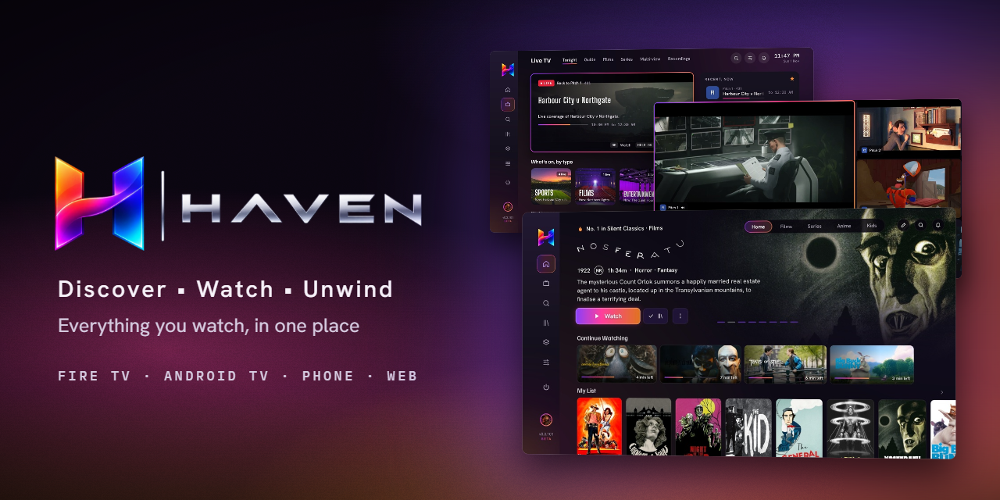
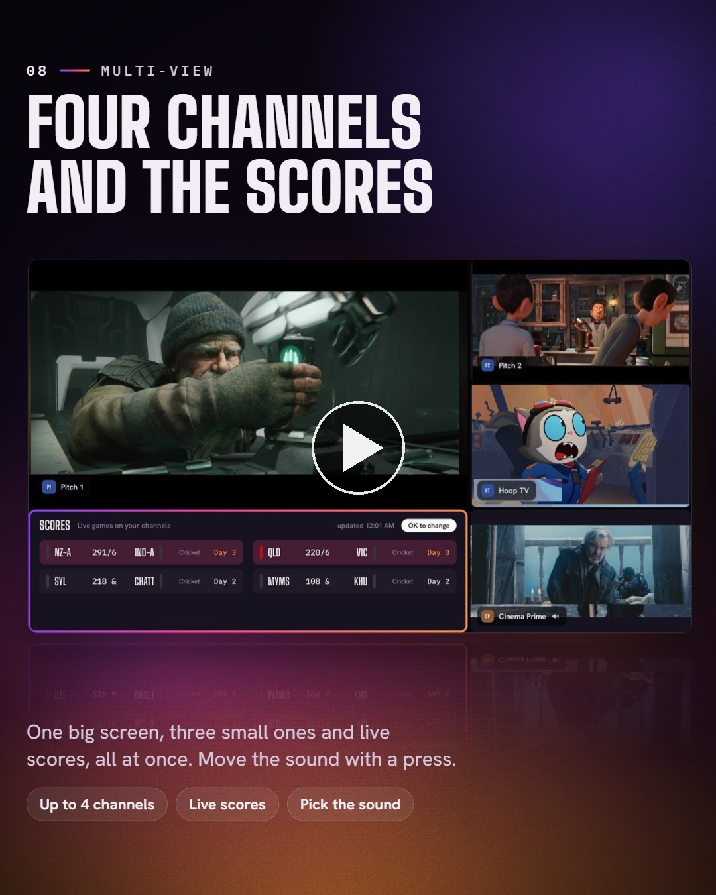
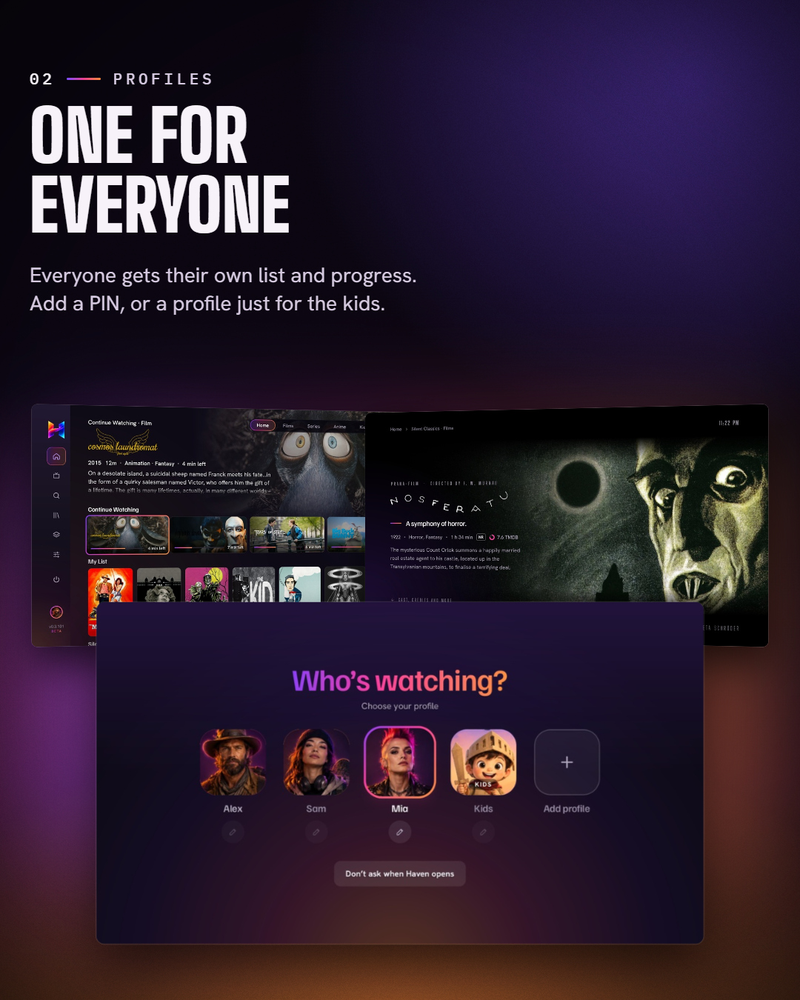
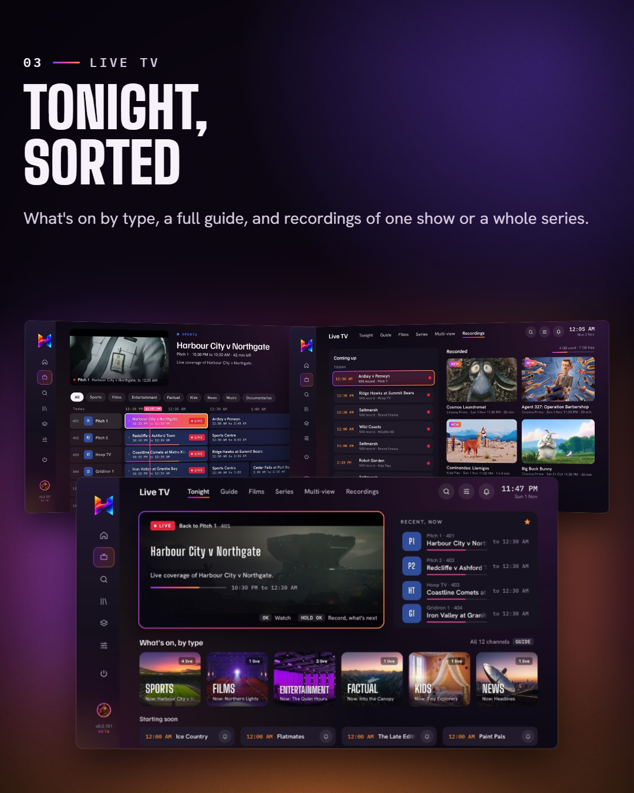
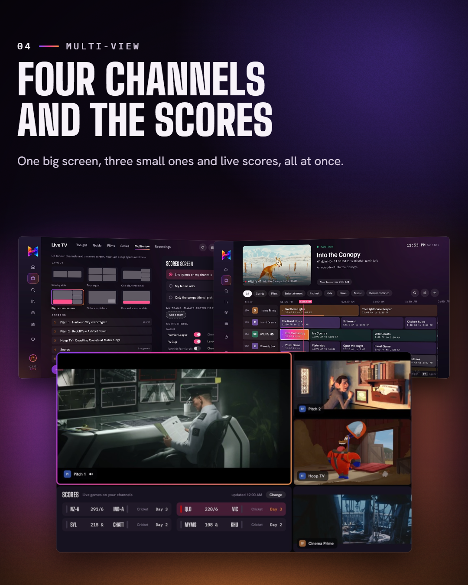
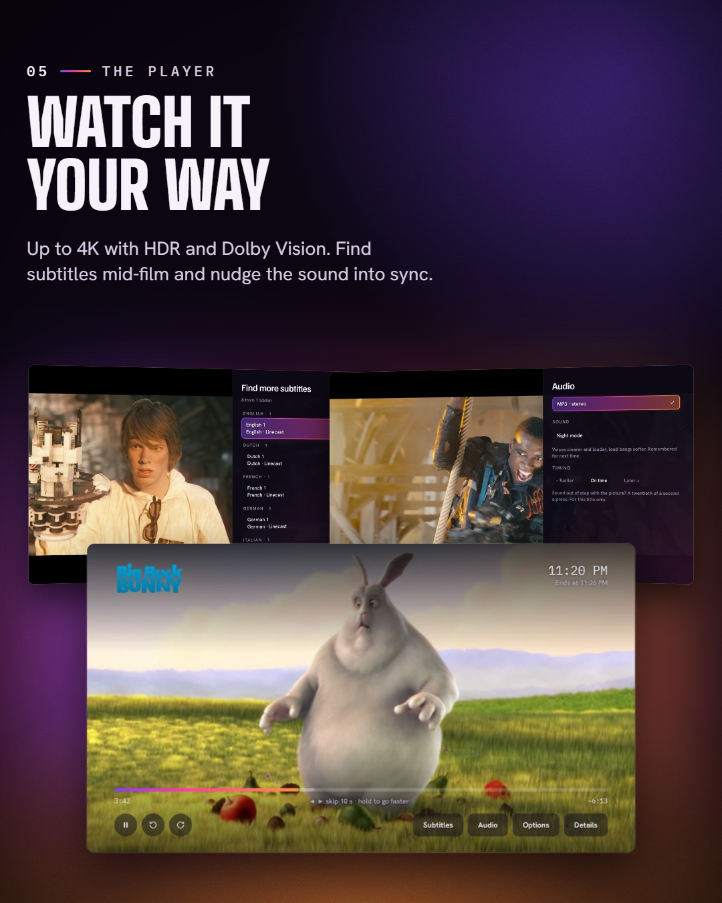
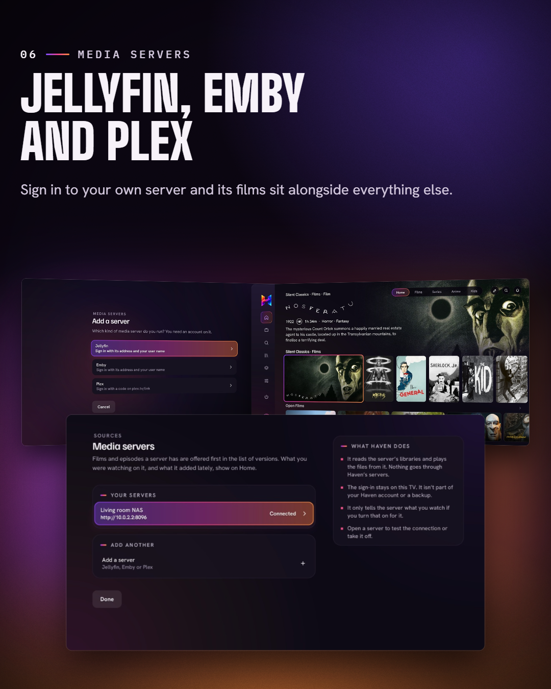
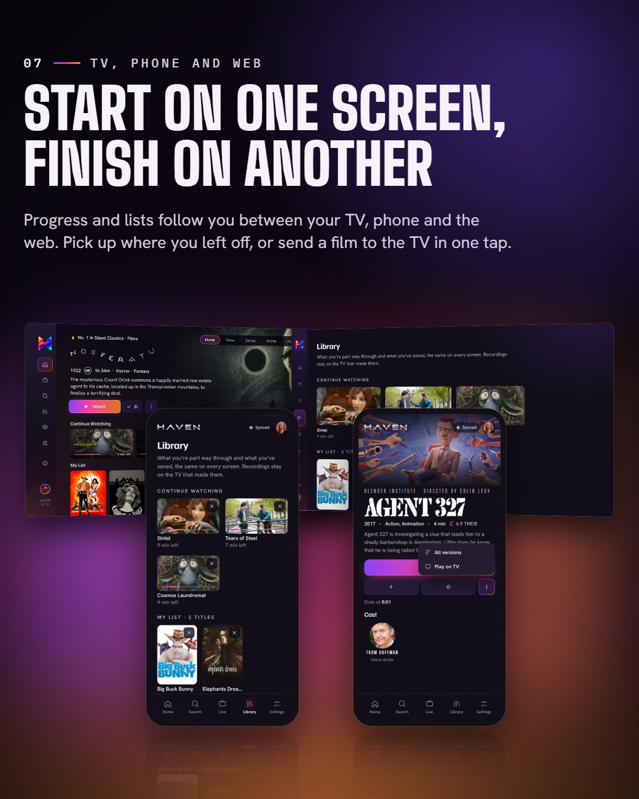
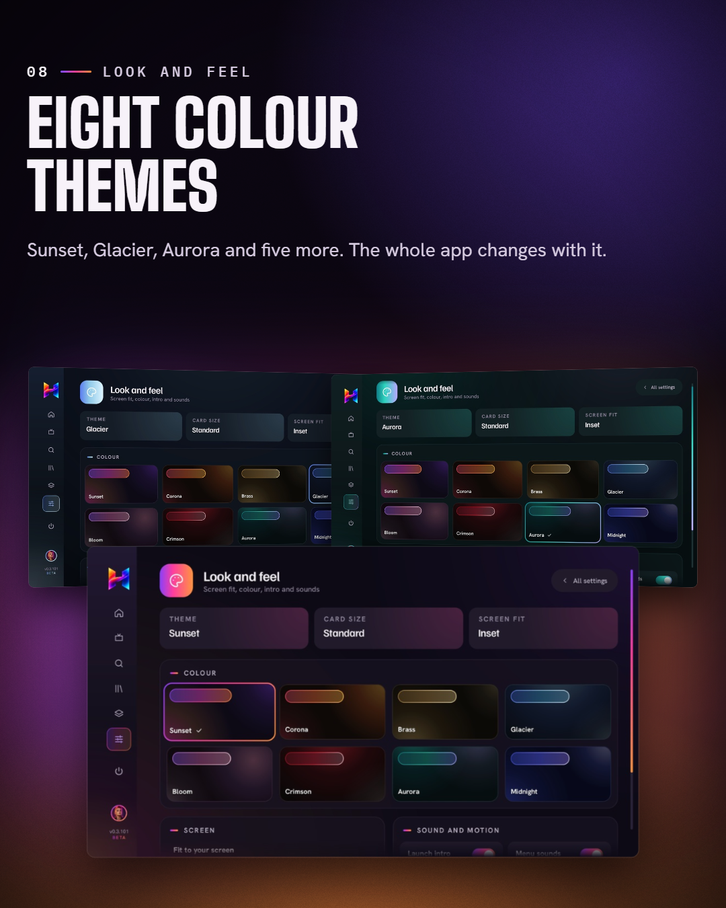

  

  <a href="https://github.com/D6OMFX/haven-releases/releases/latest"><b>Download the latest release</b></a>
  &nbsp;·&nbsp;
  <a href="https://gethaven.tv">gethaven.tv</a>
  &nbsp;·&nbsp;
  <a href="assets/haven-trailer.mp4">Watch the trailer</a>

 

Haven puts everything you watch on one calm, good-looking screen. Your films and series, your TV service with a proper guide, your own Jellyfin, Emby or Plex server, all in one place on Fire TV and Android TV, with your phone and the web kept in step.

Haven doesn't come with films or channels. It plays what you add to it: your own media server, a TV service you have, and the addons you choose.

 

  
   
  The trailer, 65 seconds

 

## What's inside

<table>
  <tr>
    <td width="33%" valign="top"> <b>A profile for everyone</b> Own lists and progress for each person, a PIN if you want one, and kids profiles.</td>
    <td width="33%" valign="top"> <b>Live TV, sorted</b> Tonight grouped by type, a full guide, reminders, and recordings of one show or a whole series.</td>
    <td width="33%" valign="top"> <b>Multi-view</b> Up to four channels at once with live scores beside them. Move the sound with a press.</td>
  </tr>
  <tr>
    <td valign="top"> <b>A player that gets it right</b> Up to 4K with HDR and Dolby Vision, subtitle search mid-film, sound sync and night mode.</td>
    <td valign="top"> <b>Jellyfin, Emby and Plex</b> Sign in to your own server and its library sits alongside everything else.</td>
    <td valign="top"> <b>TV, phone and web</b> Start on one screen and finish on another. Send a film to the TV in one tap.</td>
  </tr>
  <tr>
    <td valign="top"> <b>Eight colour themes</b> Sunset, Glacier, Aurora and five more. The whole app changes with it.</td>
    <td valign="top" colspan="2">
      <b>And the small things</b>
      <ul>
        <li>Skip intro, and the next episode lined up for you</li>
        <li>Home rows you can add, hide and reorder</li>
        <li>Trakt sync that merges, never overwrites</li>
        <li>Reminders that pop up on any screen, even mid-film</li>
        <li>Updates from inside the app, one button</li>
      </ul>
    </td>
  </tr>
</table>

## Get Haven

**Fire TV**

1. Install **Downloader** from the Amazon Appstore.
2. Type the code **`3915738`** and press Go.
3. Install Haven when it asks.

**Android TV and phones**

Download `haven.apk` from the [latest release](https://github.com/D6OMFX/haven-releases/releases/latest), or go to [gethaven.tv/download](https://gethaven.tv/download).

**Web**

Sign in at [gethaven.tv](https://gethaven.tv) to see your lists and progress and send things to your TV.

Once it's installed, Haven checks for updates itself. New versions show up in Settings.

## Releases

Every version is on the [releases page](https://github.com/D6OMFX/haven-releases/releases), with what changed in each one.

 

  Films shown in the trailer and images are open movies by Blender Studio (CC BY) and public domain classics. Channels, listings, servers and addons shown are made up for the demo. Trailer music: “Volatile Reaction” by Kevin MacLeod (incompetech.com), licensed under Creative Commons: By Attribution 4.0.

